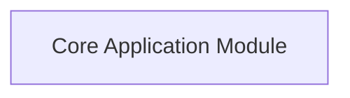

# Dependency Architecture & Topology — Repository

> **Generated by ForgeAI** | Version: `v1.0.0` | Commit: `370ec25abf3148e91633ed2236bdf4fbd67f2733`

## 1. Overview & Connectivity
- **Internal Graph Edges:** 0 static connections (CALLS, IMPORTS, EXTENDS).
- **Cross-Repository Dependencies:** 0 upstream/downstream services.

## 2. Module Dependency Graph (Mermaid)

## 3. Cross-Repository Distributed Dependencies
| Target Repository | Dependency Type | Scope | Version Spec |
| :--- | :--- | :--- | :--- |
| No external repository dependencies declared | `STANDALONE` | `INTERNAL` | `N/A` |

## 4. Key Static References
| Source Symbol | Target Reference | Edge Type |
| :--- | :--- | :--- |
| `Core` | `Standard Library` | `IMPORTS` |
