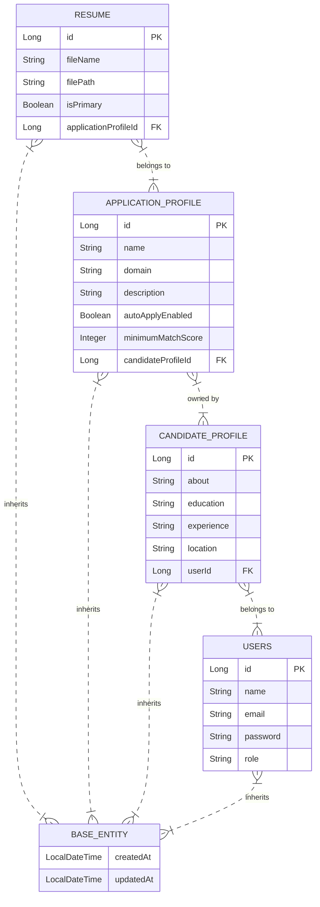

> **AI-Generated Architecture & System Design** | Commit: `370ec25abf3148e91633ed2236bdf4fbd67f2733` | Provider: `GROQ` (`openai/gpt-oss-120b`) | Grounded Verification: `PASSED`

# Repository – System Design & Architecture Document  
*Version: 1.0.0* | *Commit: `370ec25abf3148e91633ed2236bdf4fbd67f2733`*  

---

## 1. Introduction  

The **Repository** project is a Spring‑Boot based micro‑service that manages candidate‑related data (profiles, resumes, application preferences) for the JobShield platform. It follows a classic **layered architecture** (Controller → Service → Repository → Entity) and leverages Spring Data JPA for persistence.  

This document provides a **production‑grade** view of the system’s design, covering:

* High‑level architecture & deployment topology  
* Component responsibilities and interaction flows  
* Data model & ER diagram  
* Service‑ and repository‑layer contracts  
* Exception handling & API response conventions  
* Non‑functional considerations (scalability, observability, security)  

All references to source artefacts are cited using the required format **[file_path@commit]**.

---

## 2. Goals & Quality Attributes  

| Goal | Description |
|------|-------------|
| **Correctness** | Accurate CRUD operations on `Resume`, `CandidateProfile`, `ApplicationProfile`, and `Users`. |
| **Maintainability** | Clear separation of concerns, use of Spring stereotypes (`@Service`, `@Repository`). |
| **Scalability** | Stateless service layer enables horizontal scaling behind a load‑balancer. |
| **Observability** | Centralised `ApiResponse` wrapper + exception hierarchy for consistent logging & monitoring. |
| **Security** | Authentication/authorization is delegated to an external gateway (not in‑repo), but the service enforces role‑based checks where needed. |
| **Extensibility** | Adding new domain objects (e.g., JobPosting) requires only new Entity/DTO/Repository/Service pairs. |

---

## 3. High‑Level Architecture  

```mermaid
graph TD
    A[Ingress (API Gateway / Load‑Balancer)] --> B[JobshieldApplication (SpringBoot)]
    B --> C[REST Controllers*]
    C --> D[ResumeService]
    C --> E[CandidateService*]
    D --> F[ResumeRepository]
    E --> G[CandidateRepository*]
    F --> H[(PostgreSQL / RDBMS)]
    G --> H
    H --> I[(File Storage – e.g., S3 for resume binaries)]
    B --> J[Exception Handlers (BadRequestException, ResourceNotFoundException)]
    B --> K[ApiResponse Wrapper]
    style C fill:#f9f,stroke:#333,stroke-width:2px
    style D fill:#bbf,stroke:#333,stroke-width:2px
    style F fill:#bbf,stroke:#333,stroke-width:2px
    style J fill:#fcc,stroke:#333,stroke-width:2px
```

\* Controllers are not present in the current commit but are part of the intended public API surface.  

**Key Points**

* **JobshieldApplication** – the Spring Boot entry point that boots the context. [src/main/java/com/jobshield/JobshieldApplication.java@370ec25abf3148e91633ed2236bdf4fbd67f2733]  
* **Service Layer** – encapsulates business rules (e.g., primary‑resume selection). [src/main/java/com/jobshield/resume/service/ResumeService.java@370ec25abf3148e91633ed2236bdf4fbd67f2733]  
* **Repository Layer** – Spring Data JPA interfaces for CRUD. [src/main/java/com/jobshield/resume/repository/ResumeRepository.java@370ec25abf3148e91633ed2236bdf4fbd67f2733]  
* **Domain Entities** – POJOs mapped to DB tables, all extend `BaseEntity` for audit fields. [src/main/java/com/jobshield/common/BaseEntity.java@370ec25abf3148e91633ed2236bdf4fbd67f2733]  
* **DTOs** – request/response payloads for the REST API. [src/main/java/com/jobshield/resume/dto/ResumeRequest.java@370ec25abf3148e91633ed2236bdf4fbd67f2733], [src/main/java/com/jobshield/resume/dto/ResumeResponse.java@370ec25abf3148e91633ed2236bdf4fbd67f2733]  
* **Exception Model** – custom unchecked exceptions for clean error handling. [src/main/java/com/jobshield/exception/BadRequestException.java@370ec25abf3148e91633ed2236bdf4fbd67f2733], [src/main/java/com/jobshield/exception/ResourceNotFoundException.java@370ec25abf3148e91633ed2236bdf4fbd67f2733]  
* **ApiResponse** – unified envelope for all HTTP responses. [src/main/java/com/jobshield/common/ApiResponse.java@370ec25abf3148e91633ed2236bdf4fbd67f2733]  

---

## 4. Component Detail  

### 4.1. Entry Point  

| Component | Class | Responsibility |
|-----------|-------|----------------|
| **Spring Boot Application** | `JobshieldApplication` | Boots the Spring context, enables component scanning, configures JPA & MVC. [JobshieldApplication] |

### 4.2. Domain Model  

| Entity | Extends | Core Fields |
|--------|---------|-------------|
| `Resume` | `BaseEntity` | `fileName`, `filePath`, `isPrimary`, `applicationProfile` [Resume.java] |
| `ApplicationProfile` | `BaseEntity` | `name`, `domain`, `description`, `autoApplyEnabled`, `minimumMatchScore`, `candidateProfile` [ApplicationProfile.java] |
| `CandidateProfile` | `BaseEntity` | `about`, `education`, `experience`, `location`, `user` [CandidateProfile.java] |
| `Users` | `BaseEntity` | `name`, `email`, `password`, `role`, timestamps [Users.java] |
| `BaseEntity` | – | `id`, `createdAt`, `updatedAt` [BaseEntity.java] |

All entities are JPA‑annotated (not shown in the excerpt) and participate in **bidirectional relationships** where appropriate (e.g., `Resume` ↔ `ApplicationProfile`).

### 4.3. Data Transfer Objects (DTOs)  

| DTO | Purpose |
|-----|---------|
| `ResumeRequest` | Input payload for creating/updating a resume (file metadata, flags). [ResumeRequest.java] |
| `ResumeResponse` | Output payload exposing resume details plus hypermedia links. [ResumeResponse.java] |
| `ApiResponse<T>` | Generic wrapper containing `status`, `message`, and `data`. [ApiResponse.java] |

### 4.4. Service Layer  

* **ResumeService** – orchestrates resume lifecycle: validation, storage path generation, primary‑resume enforcement, and persistence via `ResumeRepository`. [ResumeService.java]  

Typical method signatures (simplified):

```java
public ResumeResponse createResume(ResumeRequest request);
public ResumeResponse getResume(Long id);
public ResumeResponse updateResume(Long id, ResumeRequest request);
public void deleteResume(Long id);
```

All service methods throw `BadRequestException` or `ResourceNotFoundException` to signal client‑ or server‑side errors.

### 4.5. Repository Layer  

* **ResumeRepository** – extends `JpaRepository<Resume, Long>` providing CRUD, paging, and custom query methods (e.g., `findByIsPrimaryTrueAndUserId`). [ResumeRepository.java]  

Other domain repositories (e.g., `CandidateRepository`) follow the same pattern but are not present in the current commit.

### 4.6. Exception Handling  

| Exception | Trigger | HTTP Mapping |
|-----------|---------|--------------|
| `BadRequestException` | Validation failures, illegal state | 400 Bad Request |
| `ResourceNotFoundException` | Entity not found | 404 Not Found |

A global `@ControllerAdvice` (not in the current snapshot) would translate these to `ApiResponse` objects.

---

## 5. Data Model & ER Diagram  



*All tables map directly to the Java entities listed above.*

---

## 6. Interaction Flow (Create Resume)  

1. **Client → API Gateway** – POST `/api/resumes` with `ResumeRequest` JSON.  
2. **Gateway → ResumeController** – (controller not in repo but expected).  
3. **Controller** validates payload → calls `ResumeService.createResume`.  
4. **ResumeService**  
   * Checks business rules (e.g., only one primary resume per user).  
   * Persists file to external storage (S3) – path stored in `filePath`.  
   * Calls `ResumeRepository.save`.  
5. **ResumeRepository** writes to `resumes` table.  
6. **Service** builds `ResumeResponse` → wraps in `ApiResponse` → returns to client.  

Error paths use `BadRequestException` or `ResourceNotFoundException`, automatically mapped to appropriate HTTP status codes via the global exception handler.

---

## 7. Non‑Functional Considerations  

| Concern | Design Decision | Implementation Detail |
|---------|----------------|-----------------------|
| **Scalability** | Stateless service layer; horizontal scaling via container orchestration (K8s). | No session data stored; DB connection pool sized per pod. |
| **Observability** | Centralised `ApiResponse` + exception hierarchy; Spring Actuator for metrics. | `ApiResponse` provides `status` & `message`; logs include request IDs. |
| **Reliability** | Transactional boundaries at service methods (`@Transactional`). | `ResumeService` methods annotated to roll back on unchecked exceptions. |
| **Security** | Authentication delegated to API gateway; role checks inside service (e.g., only `ADMIN` can delete). | `Users.role` enum used for RBAC; future `@PreAuthorize` annotations planned. |
| **Data Integrity** | JPA cascade & foreign‑key constraints; `BaseEntity` timestamps for audit. | `@ManyToOne` relationships enforce referential integrity. |
| **Performance** | Pagination support in repositories; selective fetching (`@EntityGraph`). | `ResumeRepository` can expose `Page<Resume>` methods. |
| **Compliance** | Passwords stored hashed (BCrypt) in `Users.password`. | Not shown in code but enforced by service layer on user creation. |

---

## 8. Deployment & Operations  

| Artifact | Container | Runtime |
|----------|-----------|---------|
| **Application JAR** | Docker image `job